# TeamSync 团队同步（内网 P2P 文件夹同步）

面向小团队的**纯内网、无服务器**文件夹同步桌面工具：每人电脑装一个，团队文件夹里有人新增或修改文档，其他在线成员自动拉取。

- 同步引擎：内嵌官方 [Syncthing](https://syncthing.net) v2.1.6（不自研同步协议），由 Go 内核通过 REST + 事件 API 控制（思路同 SyncTrayzor）
- 内核：Go（`core/`，`teamsyncd`），作为 Tauri sidecar 运行，对前端暴露本地 HTTP API
- 桌面端：Tauri v2 + React 19 + TypeScript + Vite + Tailwind CSS v4 + shadcn/ui + lucide-react（`app/`），简体中文界面，浅色/深色主题，托盘、通知、开机自启
- 默认纯内网：关闭全局发现、中继、NAT 穿透和使用统计，只用局域网广播发现同事

| 概览 | 团队文件夹 |
|---|---|
| 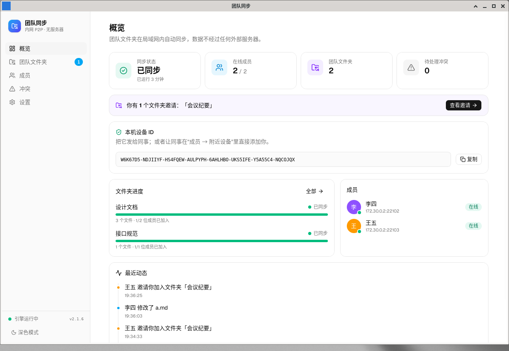 | 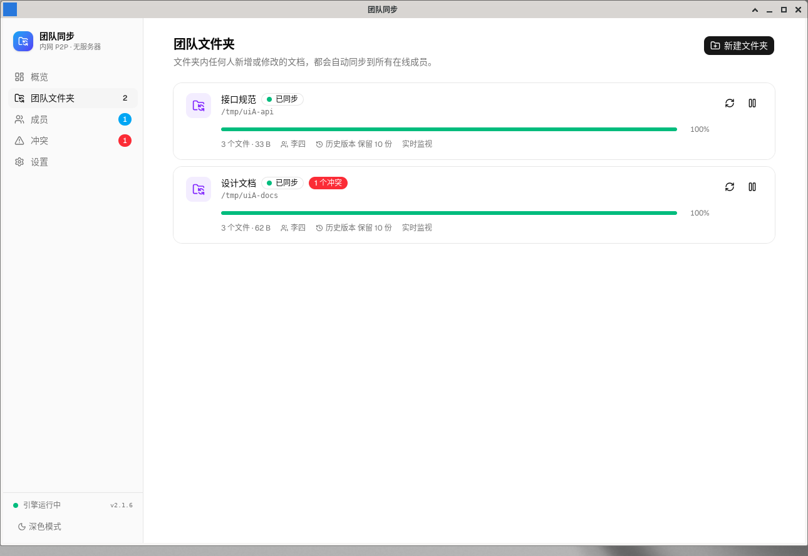 |
| **成员 / 配对** | **冲突中心** |
| 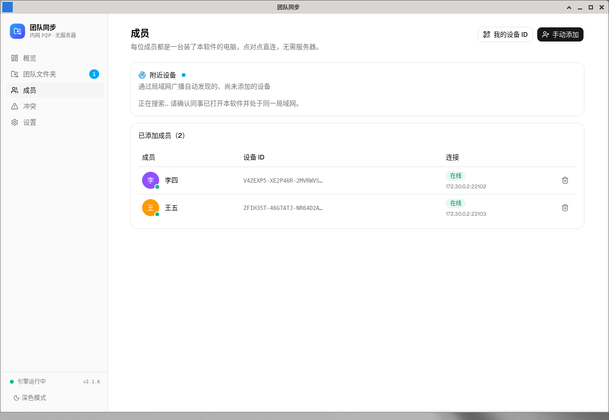 | 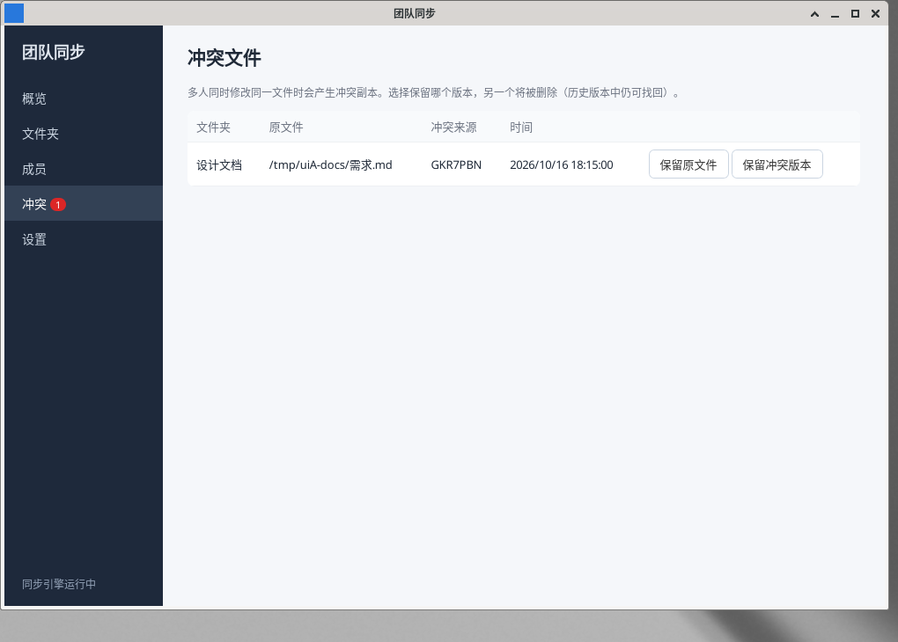 |
| **设置** | **深色主题** |
| 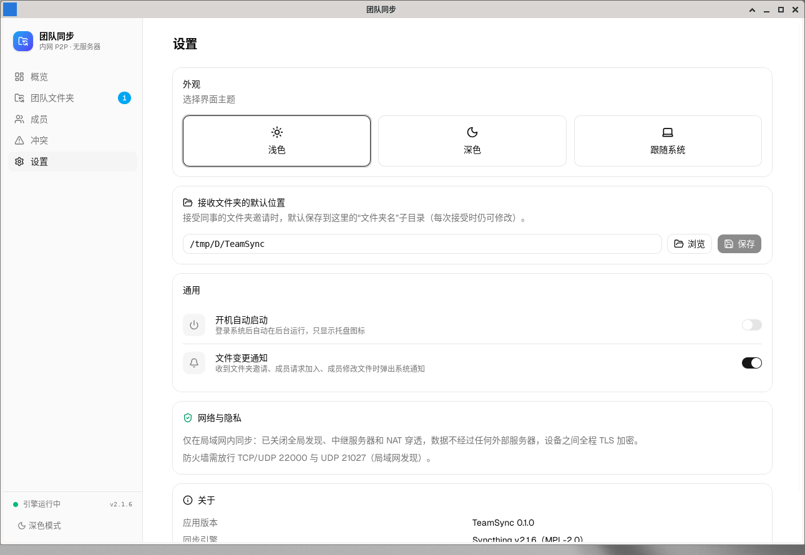 | 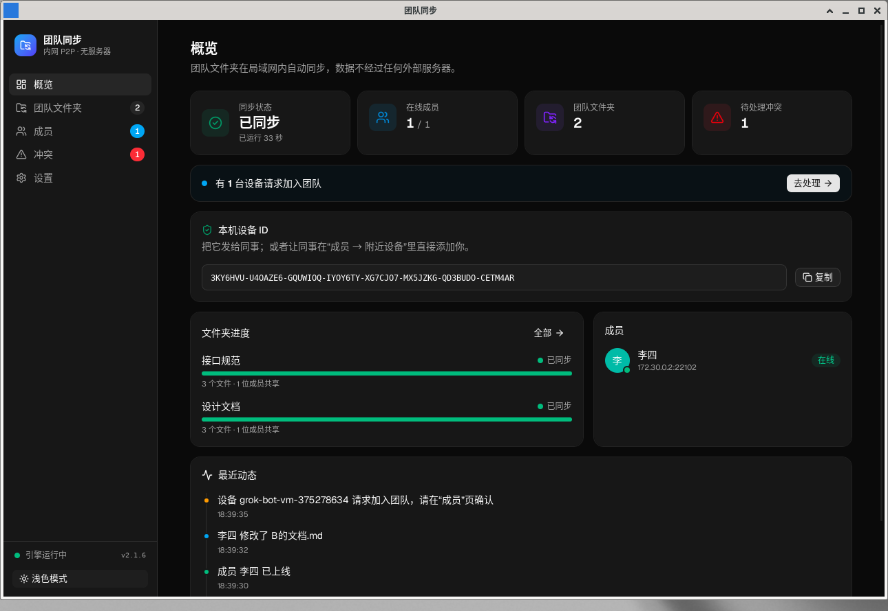 |
| **新建文件夹（选择成员）** | **接受邀请（选择保存位置）** |
| 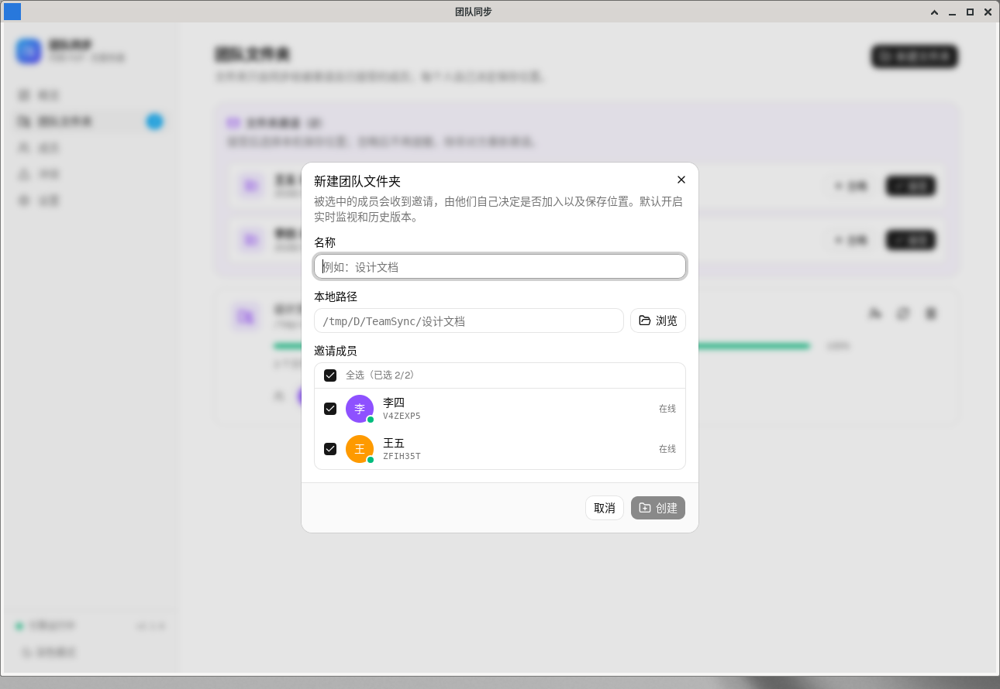 | 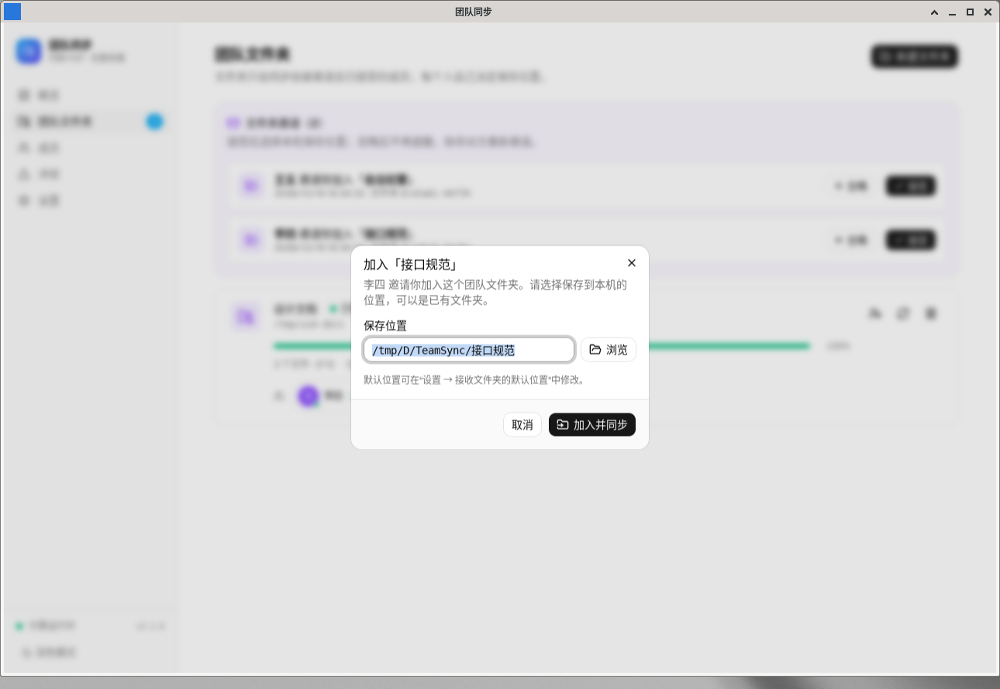 |
| **移除文件夹** | **移除并删除本地文件** |
| 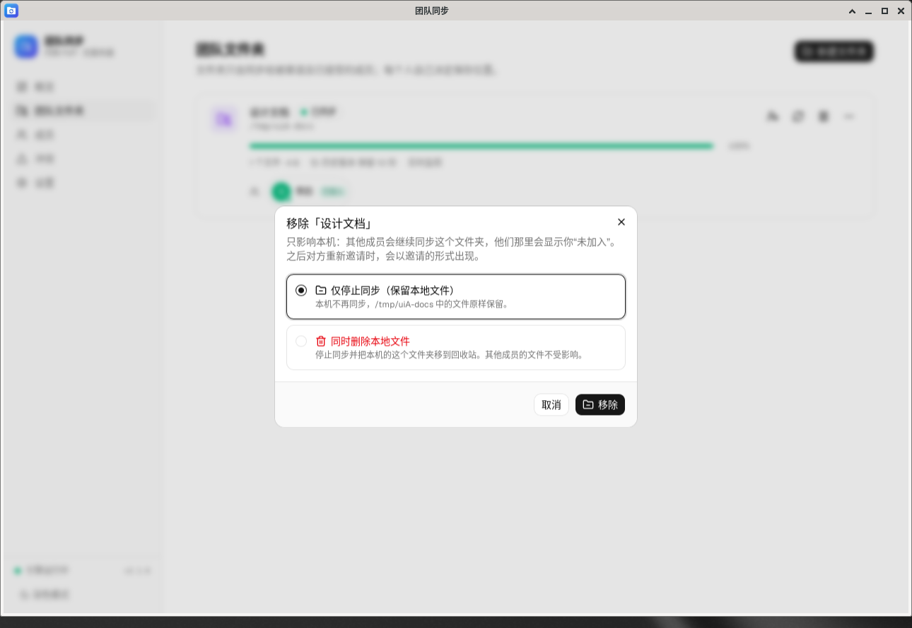 | 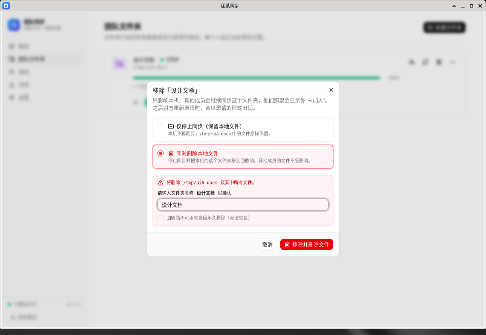 |

## 功能（MVP）

| 功能 | 说明 |
|---|---|
| 引擎管理 | 隐藏启动 syncthing（`--no-browser --no-restart`），REST 仅监听 `127.0.0.1` 随机端口，每次启动随机 API Key（`STGUIAPIKEY`），`STNOUPGRADE=1` 禁止自升级；崩溃自动重启（指数退避）；退出时先 REST shutdown，超时再强杀；Windows 用 Job Object、Linux 用 Pdeathsig 保证不留孤儿进程 |
| 团队文件夹 | 新建时勾选要邀请的成员（默认全选），之后可随时"管理成员"增删；默认开启实时文件监视（fsWatcher）和简单版本控制（保留 10 份/30 天）；写入默认忽略规则（Office 临时文件 `~$*`、`*.tmp` 等） |
| 邀请制共享 | **不会自动接收**任何文件夹：别人共享的文件夹以"邀请"出现在“团队文件夹”页（侧栏徽标 + 系统通知），显示邀请人和文件夹名；"接受"时选择本机保存位置（默认 = 设置里的默认位置/文件夹名），"忽略"后不再提醒；文件夹卡片上显示每位成员"已加入/待接受"，对方忽略过也可点"重新邀请"再次发出 |
| 移除文件夹 | 文件夹卡片"…"菜单 → 移除：默认"仅停止同步（保留本地文件）"；或"同时删除本地文件"（需输入文件夹名确认，移到回收站：Windows 回收站 / Linux 废纸篓 / macOS 废纸篓；可选回收站不可用时永久删除）。只影响本机，其他成员继续同步并看到你"未加入"；移除后不会被自动重建，对方重新邀请时以邀请出现 |
| 局域网配对 | 显示本机设备 ID；"附近设备"列出局域网发现到的设备和请求加入的设备，点"添加/同意"即可 |
| 状态与通知 | 概览（同步状态/在线成员/文件夹数）、文件夹列表（状态、文件数、暂停/扫描）、成员在线状态；"张三 修改了 设计/接口.md"类动态与系统通知；托盘提示同步状态 |
| 只读共享 | 新建文件夹或"共享设置"里选"只读共享"：只有创建者的修改会同步，成员自动以只读方式加入（卡片显示"只读"）；成员本机改动不会传出，可一键"恢复为共享版本"，创建者可"以我的版本为准"；模式可随时切换，成员端自动跟随 |
| 删除保护 / 历史版本 | 每个文件夹可单独开关（默认开启）：被他人删除或覆盖的文件在本机保留旧版本；动态里显示"成员 X 删除了 路径"并可一键恢复；"历史版本"页支持搜索、只看已删除、查看每个版本的时间和大小，并可恢复 / 打开 / 在文件夹中显示；保留规则可配置：设置页的默认值（保留份数 1–100，默认 10；保留天数 1–365，默认 30；每个文件夹的历史版本总容量上限，默认 2 GB），单个文件夹可在"…"菜单 →"历史版本设置"中自定义；超出时内核定期（及收到修改后）从最旧的版本开始删除，并显示当前占用和"立即清理" |
| 打开文件夹 | 卡片"…"菜单第一项"打开文件夹"，或直接点击路径，在资源管理器中打开；文件夹不存在时给出提示 |
| 冲突中心 | 扫描 `*.sync-conflict-*` 副本，选择保留原文件或冲突版本 |
| 托盘/自启 | 关闭窗口最小化到托盘；单实例；开机自启（`--minimized` 只驻留托盘） |

## 目录结构

```
core/                 Go 内核（无第三方依赖）
  cmd/teamsyncd/      入口：serve 守护进程 + CLI 子命令
  internal/engine/    syncthing 进程管理
  internal/stclient/  Syncthing REST/事件客户端
  internal/team/      团队文件夹/成员模型、内网默认配置、附近设备
  internal/conflict/  冲突副本扫描与处理
  internal/api/       给前端的本地 HTTP API + SSE 事件（中文翻译）
app/                  Tauri v2 桌面端
  src/                前端 React + TS（pages/ 各页面，components/ui/ 为 shadcn 组件，lib/ 为 API 客户端与数据状态）
  src-tauri/          Rust 壳：启动 sidecar、托盘、通知、自启
  src-tauri/binaries/ sidecar 二进制（脚本生成，不入库）
scripts/              下载 syncthing、编译内核、两节点端到端测试
docs/design.md        设计文档（含 SyncTrayzor 原理分析）
app/icon-src/         图标源文件（icon.svg 应用图标、tray.svg 托盘图标）；改图标后执行 `npx tauri icon icon-src/icon-1024.png -o src-tauri/icons`
```

## 环境要求

- Go ≥ 1.22，Node ≥ 18，Rust（stable，建议用 rustup 安装最新版）
- Windows：Visual Studio 2022 生成工具（"使用 C++ 的桌面开发"）+ WebView2（Win10/11 一般自带）
- Linux：`libwebkit2gtk-4.1-dev libayatana-appindicator3-dev librsvg2-dev build-essential`

## 下载 Windows 安装包（GitHub Actions）

每次推送到 `main`，GitHub Actions 会自动在 Windows 上构建安装包（工作流：`.github/workflows/build-windows.yml`，也可在 Actions 页面手动 "Run workflow"）：

1. 打开仓库的 **Actions → 构建 Windows 安装包**，点开最新一次成功的运行；
2. 在页面底部 **Artifacts** 下载 `TeamSync-windows-x64`（zip，内含 NSIS 安装程序 `TeamSync_x.y.z_x64-setup.exe` 和 MSI 包 `TeamSync_x.y.z_x64_en-US.msi`）；
3. 正式版本请到 [Releases](https://github.com/dimabehrs538-wq/lan-sync/releases/latest) 下载。

本机数据存放在哪、会不会无限增大：见 [docs/storage.md](docs/storage.md)。

**文件夹位置规则（v0.2.8 起）**：每个团队文件夹必须有单独的位置。接受邀请时默认放到“接收文件夹的默认位置\文件夹名”（重名或目录非空时自动用“名称 (2)”）；不能使用默认位置本身、磁盘根目录、用户主目录、桌面或下载目录，也不能与已有团队文件夹相同或互相嵌套。所选目录非空时会先确认。旧版本留下的重叠文件夹会被自动暂停（保留先添加的那个），在卡片上“重新选择位置”后自动恢复。

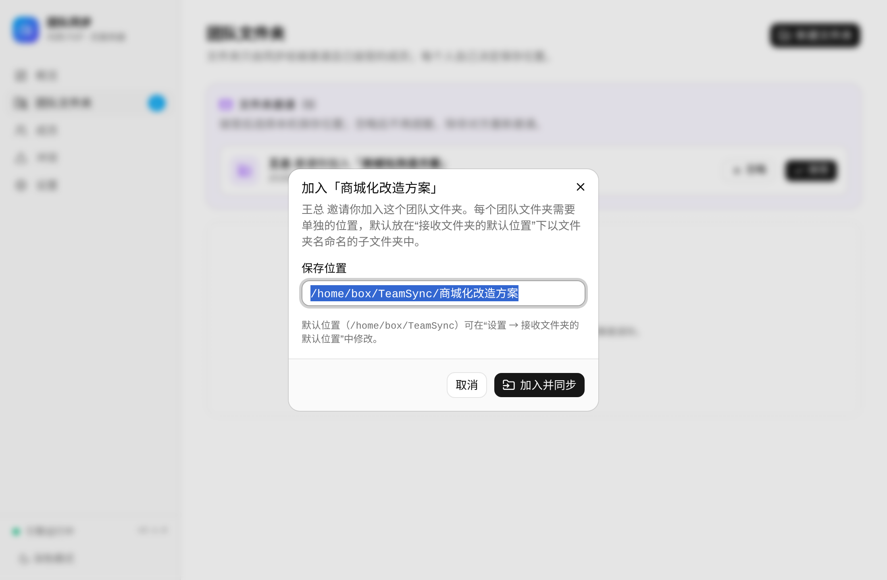

> 安装包暂未代码签名，首次运行 Windows SmartScreen 可能提示"未知发布者"，点"更多信息 → 仍要运行"即可。

## 发布新版本与自动更新

TeamSync 使用 `tauri-plugin-updater` 从 GitHub Releases 自动更新：启动 15 秒后及每 4 小时检查一次
`https://github.com/dimabehrs538-wq/lan-sync/releases/latest/download/latest.json`（设置页可关闭自动检查或手动"检查更新"）。
发现新版本时弹出中文对话框（版本号 + 更新说明），点"立即更新"后下载（带进度条）→ 停止内核与 Syncthing → 运行 NSIS 安装程序（passive 模式）→ 自动重启。

发布步骤：

1. 把版本号同步改到三处：`app/package.json`、`app/src-tauri/Cargo.toml`、`app/src-tauri/tauri.conf.json`（工作流会检查标签与 `tauri.conf.json` 一致）；
2. 提交并推送到 `main`；
3. 打带说明的标签并推送，标签说明即更新对话框里显示的"更新说明"：
   ```bash
   git tag -a v0.2.1 -m "修复了……"
   git push origin v0.2.1
   ```
4. Actions 会构建签名的 NSIS/MSI，生成 `latest.json`，并创建 Release（附安装包、`.sig` 签名和 `latest.json`）。已安装的旧版本随后会提示更新。

签名密钥：更新包用 `npx tauri signer generate` 生成的密钥签名，公钥写在 `tauri.conf.json` 的 `plugins.updater.pubkey`，
私钥及其密码保存在仓库 Secrets `TAURI_SIGNING_PRIVATE_KEY` / `TAURI_SIGNING_PRIVATE_KEY_PASSWORD`（另有离线备份，切勿提交到仓库）。
**私钥丢失后已安装的客户端将无法再自动更新**，只能手动重装。

## Windows 构建（主平台）

在 PowerShell 中（仓库根目录）：

```powershell
# 1. 下载并校验官方 syncthing.exe
powershell -ExecutionPolicy Bypass -File scripts\fetch-syncthing.ps1
# 2. 编译 Go 内核 sidecar
powershell -ExecutionPolicy Bypass -File scripts\build-core.ps1
# 3. 构建安装包（NSIS 中文安装程序 + MSI）
cd app
npm install
npx tauri build
# 产物：app\src-tauri\target\release\bundle\nsis\TeamSync_0.2.0_x64-setup.exe
```

开发调试：`cd app && npx tauri dev`。

前端单独调试：先用 CLI 跑一个内核（`teamsyncd serve`），再 `cd app && npm run dev`，浏览器打开 `http://localhost:5173/?port=<端口>&token=<token>`（端口和 token 见数据目录下的 `daemon.json`）。添加 shadcn 组件：`npx shadcn@latest add <组件名>`。

**防火墙**：首次运行 Windows 会询问是否允许 syncthing 访问网络，请勾选"专用网络"。或管理员执行：

```powershell
New-NetFirewallRule -DisplayName "TeamSync TCP" -Direction Inbound -Protocol TCP -LocalPort 22000 -Action Allow -Profile Private,Domain
New-NetFirewallRule -DisplayName "TeamSync UDP" -Direction Inbound -Protocol UDP -LocalPort 22000,21027 -Action Allow -Profile Private,Domain
```

## Linux / macOS 构建

```bash
scripts/fetch-syncthing.sh            # 默认当前系统，可指定：scripts/fetch-syncthing.sh v2.1.6 windows amd64
scripts/build-core.sh                 # 可指定：scripts/build-core.sh windows amd64
cd app && npm install && npx tauri build --bundles deb   # macOS: --bundles dmg
```

## 只用内核 / CLI

```bash
cd core && go build -o teamsyncd ./cmd/teamsyncd
./teamsyncd serve --syncthing /path/to/syncthing      # 数据目录默认 <用户配置目录>/TeamSync
# 另开终端：
./teamsyncd status                      # 本机设备 ID 和状态
./teamsyncd add-folder 设计文档 ~/设计文档 [设备ID...]   # 不写设备 = 邀请全部成员
./teamsyncd share <文件夹ID> <设备ID...>                 # 修改共享成员
./teamsyncd reinvite <文件夹ID> <设备ID>                 # 重新邀请
./teamsyncd remove-folder <文件夹ID> [--delete-files] [--permanent]  # 仅本机移除（可删除本地文件，默认进回收站）
./teamsyncd invites                                       # 收到的邀请
./teamsyncd accept-invite <文件夹ID> <邀请人ID> [本地路径]
./teamsyncd ignore-invite <文件夹ID> <邀请人ID>
./teamsyncd settings [默认存放目录]
./teamsyncd nearby                      # 局域网发现的设备 / 待确认设备
./teamsyncd add-device <设备ID> 张三
./teamsyncd accept <设备ID>
./teamsyncd folders | devices | conflicts | scan <文件夹ID>
```

`serve` 参数：`--home` 数据目录、`--folders-dir` 接收邀请时的默认存放目录初始值（默认 `~/TeamSync`，之后以界面"设置"为准，保存在 `<home>/settings.json`）、`--listen` 同步监听地址（默认 22000）、`--api-port`/`--token` 本地 API、`--exit-on-stdin-close`（sidecar 模式）。

## 测试

```bash
cd core && go test ./...          # 单元测试
scripts/e2e-two-nodes.sh          # 本机起三个实例：配对 → 只邀请 B（C 收不到、B 不自动创建）→ 忽略 → 重新邀请再次出现 → 接受到自定义路径并双向同步 → 编辑成员邀请 C → B 仅停止同步（文件保留、不再同步、不弹邀请、重新邀请后出现）→ C 删除本地文件（进回收站，A 不受影响）
```

## 使用建议

- 两人同时改同一文档只会产生冲突副本，不会自动合并：建议"一人一文档/一人一子目录"，AI 生成文档按"作者_主题"命名。
- 重新邀请的原理：把成员从文件夹移除、约 5 秒后再加回。对方内核会先收到"邀请撤回"事件并清除对应的忽略记录（按"文件夹 + 邀请人"保存），随后的新邀请就会重新出现；仅重启/重连不会让已忽略的邀请再出现。移除文件夹时同理：本机把所有共享者记入忽略，并短暂重连一次让对方的邀请被记录下来，之后对方重新邀请即可再次出现。
- 只有在线的电脑之间才同步；建议每个人都互加所有成员，或放一台常开电脑当"中心节点"。
- 误删/误覆盖可在团队文件夹的 `.stversions` 中找回旧版本。
- **成员名称**：在“成员”页顶部可修改 **我的名称**，其他成员在下次连接时（修改后会自动重连一次）看到新名称。点成员名字（或行尾 `…` → 修改备注）可给对方设置 **备注**，备注只保存在本机、不通知对方，并且优先于对方自己设置的名称；在修改备注对话框中点“使用该名称”可清除备注、改用对方的名称。CLI：`teamsyncd my-name [名称]`、`teamsyncd rename-device <ID> <备注>`、`teamsyncd rename-device <ID> --announced`。名称最长 32 个字符，首尾空格会被去掉。从旧版本升级时，已有成员的名称视为备注保留。
- **不要删除文件夹里的 `.stfolder`**：它是 Syncthing 的"文件夹标记"。标记消失时，引擎会认为磁盘可能没挂载或文件被整体删掉，为防止把"全部删除"同步给其他成员，会停止同步该文件夹（卡片显示"需要修复"）。
  - 确认本地文件完好后，点卡片上的 **修复**（或 `teamsyncd repair <文件夹ID>`）即可重建标记并重新扫描；文件夹为空时会再次确认，防止误删同事的文件。
  - 如果整个文件夹路径都不见了（被移动/改名/磁盘未连接），卡片会提供 **重新选择位置**（`teamsyncd relocate <ID> <新路径>`）或 **移除**。
- **团队文件夹放在 git 仓库里时**（如 `项目/docs/mall`）：请在仓库 `.gitignore` 中加入下面两行，并避免执行 `git clean -x`/`git clean -fdx`（它会删除被忽略的文件，包括 `.stfolder`）。TeamSync 不会自动修改你的 `.gitignore`，只会在卡片上提示。
  ```gitignore
  .stfolder/
  .stversions/
  ```
  同样，一些清理工具 / AI 编码工具会删除"看起来没用"的隐藏目录，如遇到可把 `.stfolder` 加入它们的排除列表。标记名可以用 Syncthing 的 `markerName` 选项修改，但为了与其他成员和官方工具保持一致，TeamSync 保持默认的 `.stfolder`（在 Windows 上会设为隐藏）。

## 许可

Syncthing 为 MPL-2.0 许可，安装包附带其 LICENSE（`SYNCTHING-LICENSE.txt`），源码见 https://github.com/syncthing/syncthing 。
