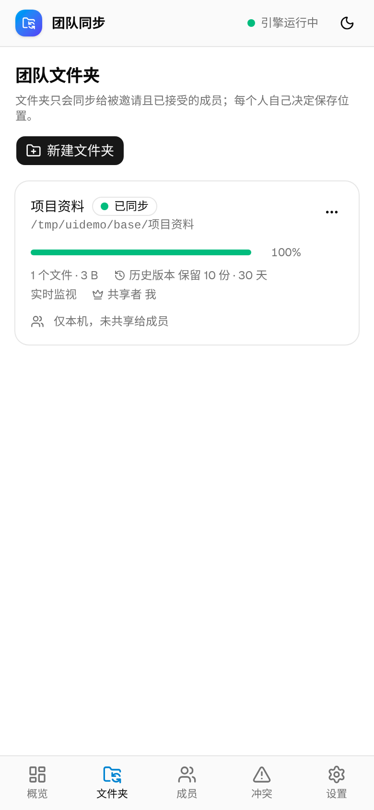
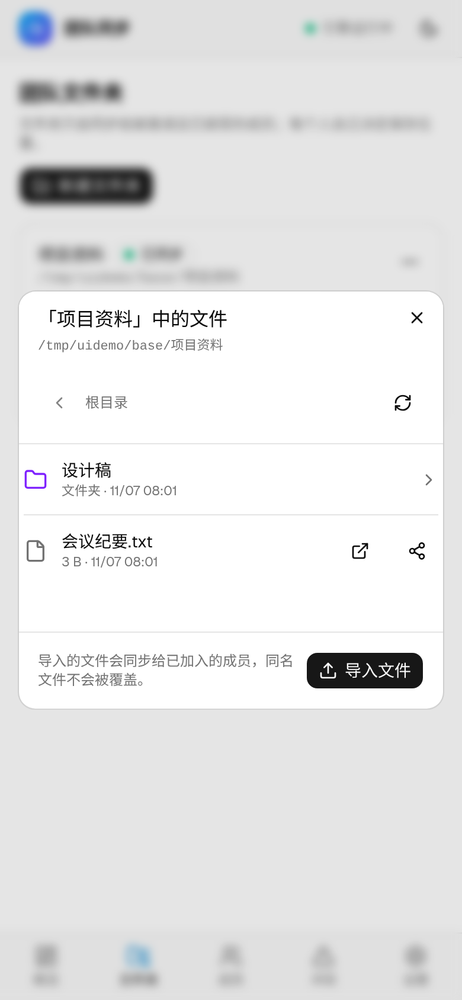
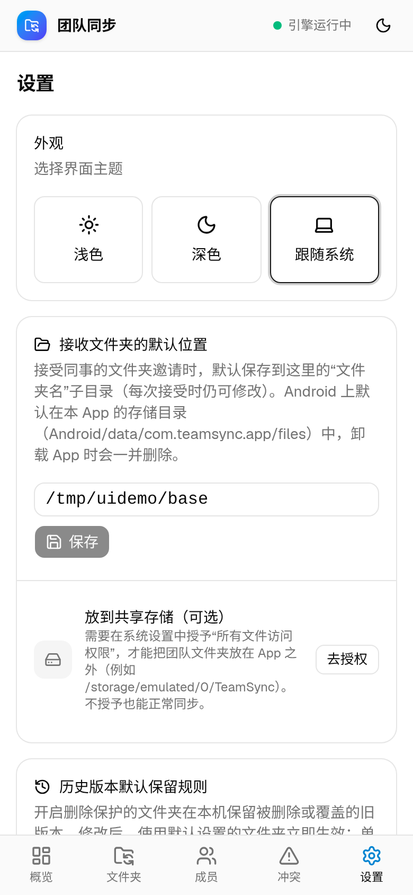

# Android / iOS 移动端

移动端与桌面端使用**同一套界面**（Tauri v2 + React）和**同一套内核 API**，同步引擎同样是官方 Syncthing v2.1.6，
因此手机和电脑之间走的是完全相同的 BEP 协议，可以互相配对、互相共享团队文件夹。

| 文件夹 | 浏览 / 导入 / 分享 | 设置（Android） |
|---|---|---|
|  |  |  |

## 架构

```
React 界面（与桌面相同，按平台裁剪）
   │  HTTP + SSE（127.0.0.1 随机端口 + Bearer Token，与桌面一致）
Rust（app/src-tauri/src/mobile.rs） ── FFI ──> libteamsynccore（Go，core/mobile）
                                                ├─ internal/daemon：与桌面 teamsyncd 完全相同的 API / 邀请 / 冲突 / 删除保护逻辑
                                                └─ 进程内嵌入 Syncthing v2.1.6（lib/syncthing），不启动任何子进程
```

* 桌面端仍是 `teamsyncd` sidecar + 官方 `syncthing` 二进制，**行为不变**；`core/internal/daemon` 只是把原来 `serve` 的流程抽出来复用。
* 手机上不能（也不应）启动子进程，所以 `core/mobile` 把 Syncthing 作为库嵌入：Android 编译为 `libteamsynccore.so`（c-shared），iOS 编译为 `libteamsynccore.a`（c-archive），`scripts/build-mobile-core.sh` 负责编译。
* 默认纯内网：与桌面相同的 LANOptions（关闭全局发现、中继、NAT、使用统计），在引擎**第一次启动前**写入配置，不会连接任何公网服务。
* 桌面专属插件（托盘、开机自启、单实例、shell sidecar、自动更新）只在桌面编译和授权（`capabilities/desktop.json`）；桌面的更新公钥和 endpoint 未改动。

## 支持的功能

| 功能 | Android | iOS |
|---|---|---|
| 配对：局域网自动发现 | ✅（MulticastLock） | ❌ 需要 Apple 的 multicast entitlement，未申请 |
| 配对：输入对方 IP 手动添加 | ✅ | ✅（"成员 → 手动添加 → 对方地址"；"配对"弹窗会显示本机地址） |
| 新建 / 接受邀请 / 管理成员 / 只读共享 / 共享者记录 | ✅ | ✅ |
| 冲突中心、删除保护与历史版本恢复 | ✅ | ✅ |
| 浏览文件、导入文件（系统文件选择器） | ✅ | ✅ |
| 分享 / 用其他 App 打开 | ✅（FileProvider） | 分享 ✅；也可在"文件"App →"我的 iPhone → TeamSync"中直接访问 |
| 移除文件夹并删除本地文件 | ✅（手机没有回收站，为永久删除，会明确提示） | ✅（同左） |
| 文件夹位置 | 默认在 App 专属存储；授予"所有文件访问权限"后可放到共享存储 | App 的"文稿"目录 |
| 应用内更新 | 检查 GitHub 最新 Release，下载新 APK 由系统安装 | 检查新版本并提示到 Release 页下载、自行重签 |

## 后台限制（请务必了解）

* **Android**：App 在前台时正常同步。设置里可以打开"后台同步"（前台服务，通知栏常驻）；系统仍可能因省电策略结束进程，
  Android 15 起 `dataSync` 前台服务每天最多运行约 6 小时，超时后系统会停止它，回到前台后会继续同步。
  未开启时切到后台很快就会停止同步。
* **iOS**：系统不允许此类 App 在后台持续运行网络服务，切到后台或锁屏后几秒到几十秒内就会被挂起，**只有 App 在前台时才同步**。
  另外 iOS 没有局域网广播发现，需要手动输入对方地址配对；首次使用会弹出"本地网络"权限，必须允许。

## 安装与签名

* **Android**：Release 中的 `TeamSync_<版本>_android_arm64.apk` 使用项目专用的发布证书签名（v1/v2/v3），可直接安装
  （需要允许"安装未知来源应用"）；`.aab` 用于上架应用商店。仅提供 arm64-v8a（绝大多数 2017 年后的手机）。
  以后所有版本使用同一个证书，可以覆盖升级。
* **iOS**：`TeamSync_<版本>_ios_arm64_unsigned.ipa` **未签名，不能直接安装，也未上架 App Store**。
  需要用 AltStore / SideStore / Sideloadly，或用自己的 Apple 开发者证书重签后安装（免费 Apple ID 签名 7 天后需要重签）。
  最低系统 iOS 14。

## 测试覆盖

* `scripts/e2e-mobile-desktop.sh`：一个桌面内核（官方 syncthing 二进制）+ 一个移动端内核（进程内嵌入）互通：纯内网配置、手动地址配对、
  手机作为共享者、文件导入/列表/下载 API、5 MB 文件、路径越界拒绝、冲突生成与解决、删除保护与恢复、只读文件夹拒绝导入、手机重启后身份与文件夹保留、永久删除。
* `MOBILE_NODES="B C"` / `MOBILE_NODES="A"` `scripts/e2e-two-nodes.sh`：把原有三节点 e2e 中的部分节点换成移动端内核，覆盖邀请、接受、只读、移除、重新邀请、共享者迁移等全部场景。
* Go 单元测试（`core`、`core/mobile`）：文件 API（越界 / 符号链接越界 / 只读）、地址规范化、LAN 选项。
* 以上均只使用本机回环地址和临时目录，不连接真实局域网设备或公网服务。**尚未在真机上测试**，构建与协议互通由 CI 验证。

## 本地构建

```bash
# Android（需要 JDK 17、Android SDK、NDK 27、Rust target aarch64-linux-android）
export ANDROID_HOME=… NDK_HOME=$ANDROID_HOME/ndk/27.2.12479018
scripts/build-mobile-core.sh android aarch64-linux-android
cd app && npx tauri android build --apk --aab --target aarch64
# 签名：在 app/src-tauri/gen/android/keystore.properties 写 storeFile/storePassword/keyAlias/keyPassword（已被 .gitignore 忽略）

# iOS（macOS + Xcode）
scripts/build-mobile-core.sh ios aarch64-apple-ios
cd app && npx tauri ios init --ci && npx tauri ios build --no-sign --target aarch64
```
